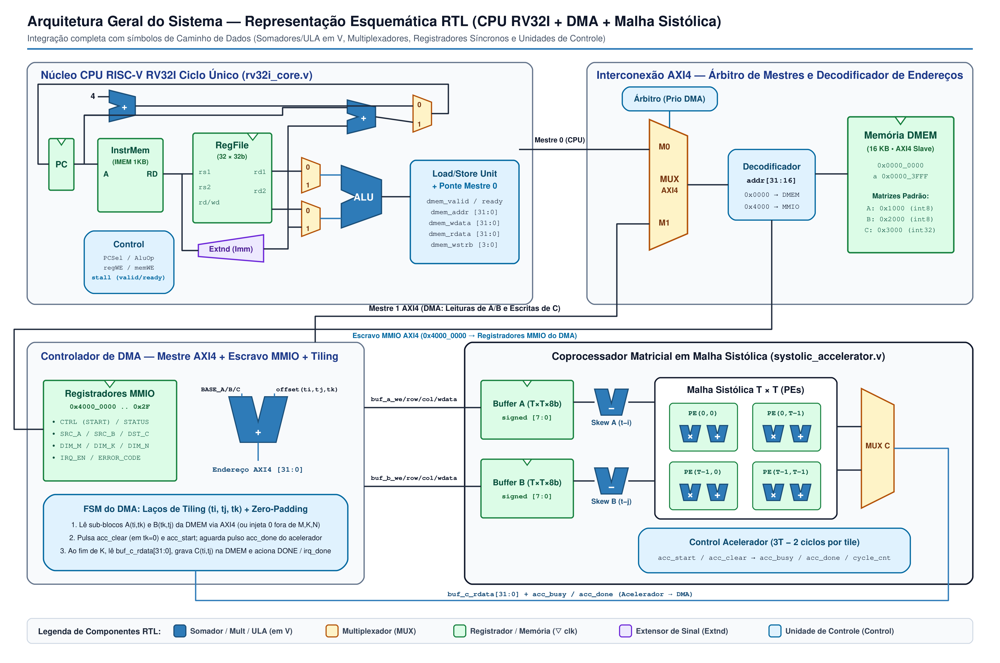
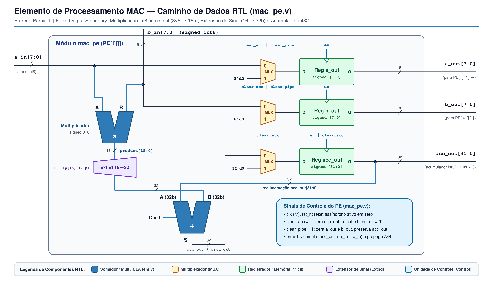
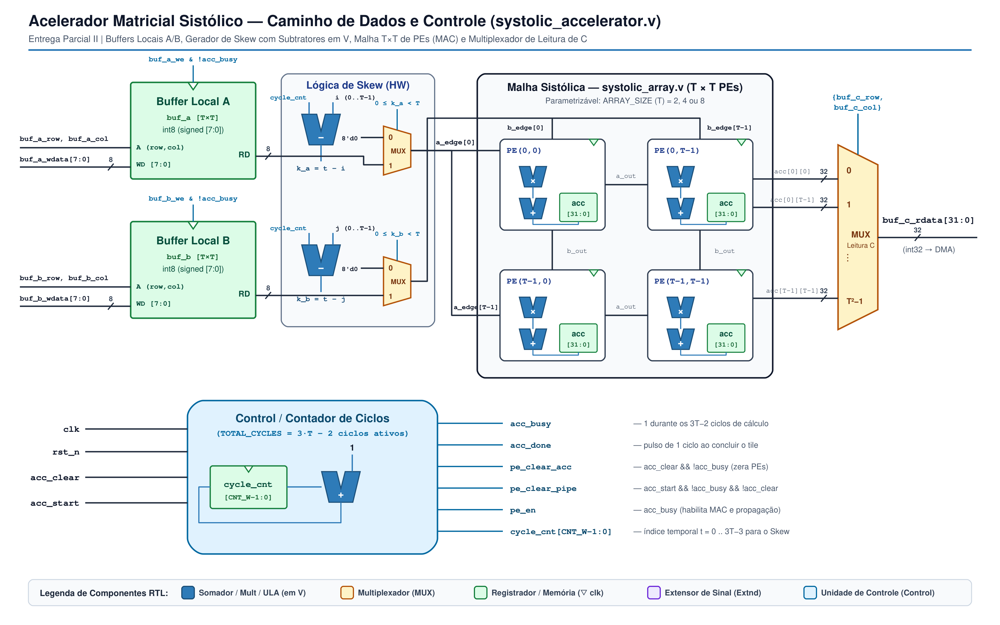
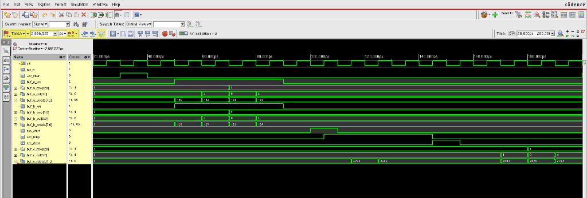
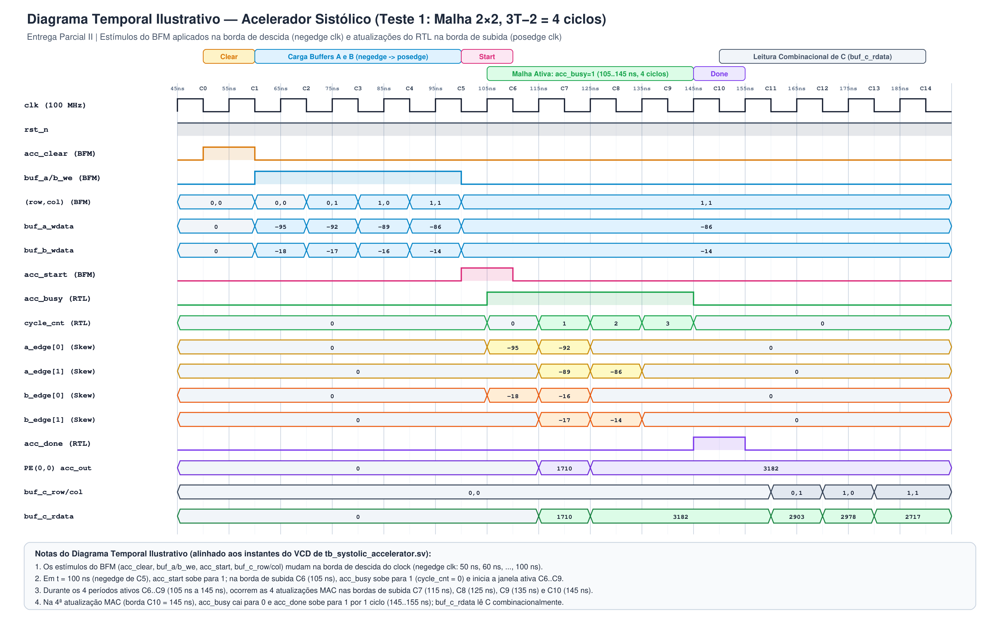

# RISC-V com DMA e acelerador de multiplicação matricial

**Entregas Parciais I e II — Planejamento, microarquitetura, modelo de referência, RTL do acelerador e testes unitários**

## 1. Objetivo

O projeto calcula C = A × B, com A de dimensão M×K, B de dimensão K×N e C de dimensão M×N. A CPU configura a operação; o DMA busca os dados e grava o resultado; o acelerador realiza as multiplicações e somas. Após o início, a CPU não transfere elementos por software.

Neste documento apresentamos a arquitetura proposta, o mapa de memória, as interfaces, o modelo de referência em Python (seção 8.a do [enunciado](Projeto%20Final%20RISCV%20DMA%20Systolic%20Array.pdf)) e o RTL do acelerador sistólico com sua verificação unitária em SystemVerilog (seção 8.b do enunciado). O processador existente está em `rv32i/`, o acelerador em `rtl/accelerator/` e o testbench unitário em `tb/unit_accelerator/`. O controlador DMA, a memória compartilhada AXI4, o firmware e o UVM integrado serão desenvolvidos nas próximas entregas.

## 2. Arquitetura proposta

Adotamos arquitetura Harvard, com memória de instruções exclusiva da CPU e memória de dados compartilhada com o DMA. Não haverá cache. O reaproveitamento dos operandos ocorre nos buffers locais e na malha sistólica.

A CPU usa uma ponte para acessar o AXI4. CPU e DMA disputam a interconexão, com prioridade fixa para o DMA, sem interromper transações em andamento. O decodificador encaminha cada acesso à memória de dados ou aos registradores do DMA.

O acelerador contém buffers A/B, lógica de atraso das entradas (skew) e uma malha de unidades MAC. A malha será parametrizada para 2×2, 4×4 e 8×8. O DMA controla o particionamento em blocos (tiling).

### Diagrama esquemático RTL da arquitetura geral

Versão para visualização e impressão: [diagrama em PDF](docs/Arquitetura_Geral.pdf).



O diagrama esquemático RTL acima representa a integração planejada. A IMEM já é instanciada dentro de 
v32i_core, mas aparece explícita no caminho de busca (PC + 4 e endereço de instrução) para mostrar a organização Harvard. O núcleo não tem pipeline e permite espera nos acessos de dados. A entrada irq_done ainda será adicionada na integração.

## 3. Dados e funcionamento do acelerador

| Decisão | Definição e motivo |
| :--- | :--- |
| Dimensões | 1 ≤ M, K, N ≤ 32, incluindo matrizes retangulares e ímpares. Cada matriz ocupa no máximo 4 KB. |
| Operandos A/B | Inteiros de 8 bits com sinal, de −128 a 127. Reduzem a largura dos multiplicadores e buffers. |
| Resultado C | Inteiro de 32 bits com sinal, sem saturação. Com K ≤ 32, a magnitude máxima é 32 × 128 × 128 = 524.288, sem overflow. |
| Armazenamento | Ordem por linhas (row-major), um elemento por palavra de 32 bits. Simplifica o DMA, mas utiliza apenas 8 dos 32 bits em cada transferência de A/B. |
| Buffers | Um buffer de T×T elementos para A e outro para B, com T = ARRAY_SIZE. C permanece nos acumuladores dos MACs. |

Em cada palavra de A/B, o valor ocupa os bits [7:0]; o exportador zera os demais bits. Por exemplo, −1 é armazenado como `000000FF`. C ocupa os 32 bits. O endereço de um elemento é:

```text
endereço(i, j) = base + 4 × (i × número_de_colunas + j)
```

Usamos o fluxo output-stationary: cada MAC mantém um acumulador de C, enquanto A avança para a direita e B para baixo. A linha i de A entra com i ciclos de atraso e a coluna j de B com j ciclos. Um produto de dois tiles T×T usa 3T−2 ciclos ideais de cálculo.

Para cada bloco de C, o DMA zera os acumuladores, carrega os blocos correspondentes de A/B e inicia o cálculo. Repete esse processo ao longo de K, preservando as somas parciais. Grava C na memória apenas após terminar a acumulação daquele bloco.

Nas bordas, o DMA preenche localmente com zero as posições fora da matriz e transfere somente os elementos válidos. Assim, a mesma malha atende matrizes maiores, menores ou não múltiplas de T.

## 4. Mapa de memória

### Memórias e regiões

A IMEM possui 256 palavras de 32 bits (1 KB), de `0x00000000` a `0x000003FF`, carregadas por arquivo hexadecimal. Seu espaço é separado da memória de dados.

A DMEM planejada possui 16 KB. O mapa abaixo indica a distribuição padrão; as bases das matrizes são configuráveis.

| Faixa de endereços | Uso |
| :--- | :--- |
| `0x00000000–0x00000FFF` | Dados gerais e pilha da CPU |
| `0x00001000–0x00001FFF` | Matriz A, base padrão `0x1000` |
| `0x00002000–0x00002FFF` | Matriz B, base padrão `0x2000` |
| `0x00003000–0x00003FFF` | Matriz C, base padrão `0x3000` |
| `0x40000000–0x4000002F` | Registradores do DMA/acelerador |

As bases devem ser alinhadas em 4 bytes. As regiões A, B e C não podem se sobrepor e devem caber integralmente na DMEM. O firmware também deve preservar sua pilha e seus dados. Os tamanhos das regiões são 4×M×K, 4×K×N e 4×M×N bytes, respectivamente.

A decodificação verifica os limites completos das faixas, não apenas os bits superiores. Acessos fora delas recebem erro (`DECERR`), sem acessar memória ou registradores. Toda a rajada deve caber na região selecionada. Por exemplo, `0x00010000` não é um endereço válido da DMEM.

### Registradores

Escolhemos oito registradores de configuração e controle. Também incluímos três contadores para a comparação de desempenho e um identificador do tamanho da malha. Todos têm 32 bits; os endereços abaixo indicam o primeiro byte de cada palavra.

| Offset | Endereço Absoluto | Nome do Registrador | Acesso | Valor Reset | Descrição dos Campos e Bits |
| :---: | :---: | :--- | :---: | :---: | :--- |
| `0x00` | `0x4000_0000` | `DMA_CTRL` | R/W | `0x0000_0000` | **`bit[0]` (`START`):** Escrever `1` dispara a operação autônoma do DMA (auto-limpante).<br>**`bit[1]` (`IRQ_EN`):** `1` habilita geração do sinal de interrupção `irq_done` ao concluir.<br>**`bit[2]` (`SOFT_RST`):** `1` reinicia contadores e flags de status. |
| `0x04` | `0x4000_0004` | `DMA_STATUS` | R / W1C | `0x0000_0000` | **`bit[0]` (`BUSY`):** `1` enquanto o DMA ou o Systolic Array estão em execução.<br>**`bit[1]` (`DONE`):** `1` quando toda a matriz $C$ foi gravada na `DMEM` (limpo ao escrever `1` ou em novo `START`).<br>**`bit[2]` (`ERR`):** `1` se a configuração violar dimensões, alinhamento, capacidade da DMEM ou não sobreposição (seções 3 e 4). |
| `0x08` | `0x4000_0008` | `DMA_ADDR_A` | R/W | `0x0000_1000` | Endereço-base da **Matriz A** na `DMEM` (alinhado em 4 bytes). |
| `0x0C` | `0x4000_000C` | `DMA_ADDR_B` | R/W | `0x0000_2000` | Endereço-base da **Matriz B** na `DMEM` (alinhado em 4 bytes). |
| `0x10` | `0x4000_0010` | `DMA_ADDR_C` | R/W | `0x0000_3000` | Endereço-base da **Matriz C** na `DMEM` (alinhado em 4 bytes). |
| `0x14` | `0x4000_0014` | `DMA_DIM_M` | R/W | `0x0000_0004` | Número de linhas da Matriz $A$ e da Matriz $C$ ($1 \le M \le 32$). |
| `0x18` | `0x4000_0018` | `DMA_DIM_K` | R/W | `0x0000_0004` | Número de colunas de $A$ e linhas de $B$ ($1 \le K \le 32$). |
| `0x1C` | `0x4000_001C` | `DMA_DIM_N` | R/W | `0x0000_0004` | Número de colunas da Matriz $B$ e da Matriz $C$ ($1 \le N \le 32$). |
| `0x20` | `0x4000_0020` | `PERF_TOTAL_CYCLES` | RO | `0x0000_0000` | Ciclos totais entre `START` e `DONE` (DMA + Malha). |
| `0x24` | `0x4000_0024` | `PERF_COMP_CYCLES` | RO | `0x0000_0000` | Ciclos com a malha ativa (`acc_busy = 1`). |
| `0x28` | `0x4000_0028` | `PERF_MEM_READS` | RO | `0x0000_0000` | Palavras lidas da DMEM pelo DMA. |
| `0x2C` | `0x4000_002C` | `HW_ARRAY_SIZE` | RO | `ARRAY_SIZE` | Retorna o parâmetro físico `ARRAY_SIZE` sintetizado ($2, 4$ ou $8$). |

Uma configuração inválida apresentada quando o DMA está ocioso não inicia transferências: dimensões fora de 1 a 32, desalinhamento, sobreposição ou regiões fora da DMEM resultam em `ERR=1` e `BUSY=0`.

## 5. Interfaces

Todos os módulos usam o mesmo `clk`, com transferências na borda de subida, e reset `rst_n` ativo em zero.

### CPU e ponte AXI4

O núcleo existente está em [`rv32i/rv32i_core.v`](rv32i/rv32i_core.v). Sua interface de dados já possui espera por `valid/ready`; a ponte AXI4 será implementada posteriormente.

| Sinal | Direção (ref. CPU) | Largura | Descrição Funcional |
| :--- | :---: | :---: | :--- |
| `clk` | Entrada | 1 bit | Relógio principal do sistema (borda de subida ativa). |
| `rst_n` | Entrada | 1 bit | Reset global assíncrono, ativo em nível baixo (`0`). |
| `dmem_valid` | Saída | 1 bit | Indica que a CPU está solicitando uma leitura (`LW/LH/LB`) ou escrita (`SW/SH/SB`). |
| `dmem_ready` | Entrada | 1 bit | Indica resposta disponível para concluir a solicitação da CPU; dados/erro válidos nessa mesma borda. A ponte deve ter recebido a resposta AXI4 correspondente. |
| `dmem_write` | Saída | 1 bit | `1` = Operação de escrita (*Store*); `0` = Operação de leitura (*Load*). |
| `dmem_addr` | Saída | 32 bits | Endereço alinhado em palavra (`{alu_result[31:2], 2'b00}`). |
| `dmem_wdata` | Saída | 32 bits | Dado de escrita posicionado nos bytes correspondentes pela `load_store_unit`. |
| `dmem_wstrb` | Saída | 4 bits | Máscara de habilitação de bytes na escrita (`4'b1111`=SW, `4'b0011`/`1100`=SH, 1 bit=SB). |
| `dmem_rdata` | Entrada | 32 bits | Palavra de 32 bits lida da `DMEM` ou de um registrador MMIO. |
| `dmem_error` | Entrada | 1 bit | Indica erro de barramento (`BRESP/RRESP != OKAY`). |
| `irq_done` | Entrada | 1 bit | Conexão futura DMA → CPU, fora da ponte. Ainda não existe no núcleo atual; mecanismo de atendimento será definido na integração. |

A requisição termina na borda com `dmem_valid && dmem_ready`. Durante a espera, a CPU mantém a instrução, o endereço, a direção, os dados e a máscara. A ponte atende uma solicitação por vez e não deve repetir uma escrita. Dados de leitura e erro devem corresponder à solicitação concluída; fora da resposta, `dmem_error=0`. A conexão `irq_done` é direta entre DMA e CPU, não passa pela ponte.

### Barramento AXI4

CPU e DMA são mestres; DMEM e registradores MMIO são escravos. A CPU usa uma palavra por transação (`LEN=0`); o DMA usa rajadas INCR de palavras de 4 bytes. Prevemos uma transação em andamento por vez, sem reordenação. IDs fixos e atributos constantes serão detalhados nas portas RTL.

| Canal AXI4 | Sinal | Largura | Origem $\rightarrow$ Destino | Descrição no Sistema |
| :---: | :--- | :---: | :---: | :--- |
| **AW**<br>*(Write Address)* | `awaddr` | 32 bits | Master $\rightarrow$ Slave | Endereço inicial da escrita (simples ou *burst*). |
| | `awlen` | 8 bits | Master $\rightarrow$ Slave | Comprimento da rajada: $\text{Beats} = \text{awlen} + 1$ (`0` na CPU; $L-1$ no DMA, com $L$ palavras válidas na rajada). |
| | `awsize` | 3 bits | Master $\rightarrow$ Slave | Tamanho de cada transferência: `3'b010` (4 bytes = 32 bits). |
| | `awburst` | 2 bits | Master $\rightarrow$ Slave | Tipo de rajada: `2'b01` (`INCR` — incrementa endereço em +4 a cada beat). |
| | `awvalid` / `awready` | 1 bit | Handshake | Handshake de aceitação do endereço de escrita. |
| **W**<br>*(Write Data)* | `wdata` | 32 bits | Master $\rightarrow$ Slave | Palavra de 32 bits a ser escrita na `DMEM` ou registrador MMIO. |
| | `wstrb` | 4 bits | Master $\rightarrow$ Slave | Máscara de bytes ativos (`4'b1111` nas escritas de 32 bits do DMA). |
| | `wlast` | 1 bit | Master $\rightarrow$ Slave | `1` no último dado da rajada de escrita. |
| | `wvalid` / `wready` | 1 bit | Handshake | Handshake de transferência de cada palavra de escrita. |
| **B**<br>*(Write Resp)* | `bresp` | 2 bits | Slave $\rightarrow$ Master | Status da escrita (`2'b00 = OKAY`, `2'b10 = SLVERR`). |
| | `bvalid` / `bready` | 1 bit | Handshake | Handshake de confirmação de término da escrita. |
| **AR**<br>*(Read Address)* | `araddr` | 32 bits | Master $\rightarrow$ Slave | Endereço inicial da leitura (simples ou *burst*). |
| | `arlen` | 8 bits | Master $\rightarrow$ Slave | Comprimento da rajada: $\text{Beats} = \text{arlen} + 1$ (`0` na CPU; $L-1$ no DMA, com $L$ palavras válidas na rajada). |
| | `arsize` | 3 bits | Master $\rightarrow$ Slave | Tamanho de cada leitura: `3'b010` (4 bytes = 32 bits). |
| | `arburst` | 2 bits | Master $\rightarrow$ Slave | Tipo de rajada: `2'b01` (`INCR`). |
| | `arvalid` / `arready` | 1 bit | Handshake | Handshake de aceitação do endereço de leitura. |
| **R**<br>*(Read Data)* | `rdata` | 32 bits | Slave $\rightarrow$ Master | Palavra de 32 bits lida da `DMEM` ou MMIO. |
| | `rresp` | 2 bits | Slave $\rightarrow$ Master | Status da leitura (`2'b00 = OKAY`). |
| | `rlast` | 1 bit | Slave $\rightarrow$ Master | `1` na última palavra da rajada de leitura. |
| | `rvalid` / `rready` | 1 bit | Handshake | Handshake de entrega de cada palavra lida. |

Cada canal transfere quando VALID e READY estão altos na mesma borda. O emissor mantém VALID e conteúdo estáveis durante a espera, sem depender de READY para apresentar VALID. Endereço e dados de escrita têm canais independentes. A escrita termina na resposta B; a leitura, na aceitação do último dado R.

O DMA recebe prioridade quando ambos os mestres solicitam acesso. Uma transação iniciada termina antes da troca de mestre. Durante o cálculo na malha, o DMA libera o barramento; a CPU pode acessá-lo, sujeita à resposta do escravo.

Cada rajada transfere um trecho válido de uma linha do tile, com `LEN=L−1`. Trechos nas bordas são encurtados, e a rajada também é dividida se alcançar uma fronteira de 4 KB. Não há transferências para os zeros de padding. O acesso MMIO usa palavras alinhadas, uma por transação.

Referência do protocolo: [AMBA AXI/ACE, Arm, capítulos A3.2–A3.4](https://community.arm.com/cfs-file/__key/communityserver-discussions-components-files/476/IHI0022H_5F00_amba_5F00_axi_5F00_protocol_5F00_spec.pdf).

### DMA e acelerador

O DMA carrega os buffers e controla cada cálculo pelos sinais abaixo. `IDX_W = $clog2(ARRAY_SIZE)`.

| Sinal | Direção (DMA $\rightarrow$ Acc) | Largura | Descrição Funcional |
| :--- | :---: | :---: | :--- |
| `acc_clear` | DMA $\rightarrow$ Acelerador | 1 bit | Pulso de 1 ciclo que zera todos os acumuladores `acc[i][j]` da malha (acionado quando $tk = 0$). |
| `acc_start` | DMA $\rightarrow$ Acelerador | 1 bit | Pulso de 1 ciclo que inicia o processamento sistólico do bloco carregado nos buffers locais. |
| `acc_busy` | Acelerador $\rightarrow$ DMA | 1 bit | Permanece em `1` durante os $3T - 2$ ciclos enquanto os dados atravessam a malha com *skew*. |
| `acc_done` | Acelerador $\rightarrow$ DMA | 1 bit | Pulso de 1 ciclo indicando que o bloco atual terminou de ser acumulado nos PEs. |
| `buf_a_we` | DMA $\rightarrow$ Acelerador | 1 bit | Habilita escrita de um elemento no Buffer Local $A$. |
| `buf_a_row` | DMA $\rightarrow$ Acelerador | `IDX_W` | Índice de linha ($0 \dots T-1$) no Buffer Local $A$. |
| `buf_a_col` | DMA $\rightarrow$ Acelerador | `IDX_W` | Índice de coluna ($0 \dots T-1$) no Buffer Local $A$. |
| `buf_a_wdata` | DMA $\rightarrow$ Acelerador | 8 bits | Elemento `signed [7:0]` (`int8`) escrito no Buffer Local $A$ (ou `0` em caso de *zero-padding*). |
| `buf_b_we` | DMA $\rightarrow$ Acelerador | 1 bit | Habilita escrita de um elemento no Buffer Local $B$. |
| `buf_b_row` | DMA $\rightarrow$ Acelerador | `IDX_W` | Índice de linha ($0 \dots T-1$) no Buffer Local $B$. |
| `buf_b_col` | DMA $\rightarrow$ Acelerador | `IDX_W` | Índice de coluna ($0 \dots T-1$) no Buffer Local $B$. |
| `buf_b_wdata` | DMA $\rightarrow$ Acelerador | 8 bits | Elemento `signed [7:0]` (`int8`) escrito no Buffer Local $B$ (ou `0` em caso de *zero-padding*). |
| `buf_c_row` | DMA $\rightarrow$ Acelerador | `IDX_W` | Seleciona a linha ($0 \dots T-1$) do acumulador da malha para leitura pelo DMA. |
| `buf_c_col` | DMA $\rightarrow$ Acelerador | `IDX_W` | Seleciona a coluna ($0 \dots T-1$) do acumulador da malha para leitura pelo DMA. |
| `buf_c_rdata` | Acelerador $\rightarrow$ DMA | 32 bits | Valor acumulado `signed [31:0]` (`int32`) do elemento $\text{PE}(\text{row}, \text{col})$. |

Com `acc_busy=0`, cada `buf_a_we`/`buf_b_we` grava um elemento na borda de subida. Não há ready nessas portas: cada buffer aceita uma escrita por ciclo enquanto o acelerador está ocioso. Todos os elementos do tile, incluindo zeros de padding, são carregados antes de iniciar.

`acc_clear` zera os acumuladores antes do primeiro produto de um bloco de C. É um pulso separado de `acc_start`. Nos produtos seguintes ao longo de K, os acumuladores são preservados.

O acelerador aceita `acc_start` quando ocioso; busy sobe e a primeira atualização MAC ocorre na borda seguinte. Após 3T−2 atualizações, busy cai e done fica alto por um ciclo. A leitura de C é combinacional, selecionada por linha/coluna: após done, o DMA mantém os índices durante o ciclo e captura o valor na próxima borda. O resultado permanece até novo clear ou cálculo.

No reset (`rst_n=0`), `acc_busy`, `acc_done`, os registradores de propagação entre PEs (`a_out`, `b_out`), os acumuladores `acc[i][j]` e os buffers locais `buf_a`/`buf_b` são zerados. Enquanto `acc_busy=1`, o acelerador ignora comandos externos (`acc_start`, `acc_clear`, `buf_a_we`, `buf_b_we`), protegendo os buffers e a acumulação em andamento. Quando ocioso (`acc_busy=0`), se `acc_clear` e `acc_start` forem acionados no mesmo ciclo, `acc_clear` tem prioridade (zera os acumuladores e mantém `acc_busy=0`, exigindo pulso `acc_start` separado); ao aceitar `acc_start` com `acc_clear=0`, os registradores de passagem inter-PE são limpos preservando `acc[i][j]`. O atendimento da interrupção `irq_done` na CPU será detalhado na etapa de integração.

## 6. Modelo de referência

O código está em [`sw/golden_model/`](sw/golden_model/README.md). Mantivemos duas formas de cálculo:

- `matmul_reference_alg`: multiplicação direta, usada como resultado esperado.
- `matmul_tiled_golden`: cálculo por blocos, com simulação da malha e zero-padding.

O modelo valida dimensões e valores int8. O validador `validate_memory_layout` verifica separadamente alinhamento, limites e sobreposição das regiões. A exportação gera arquivos `.hex` em ordem por linhas para os testes futuros do RTL.

Na raiz do projeto, execute:

```powershell
python -B sw/golden_model/test_golden_model.py
python -B sw/golden_model/golden_model.py -m 8 -k 8 -n 8
```

Para gerar vetores explicitamente:

```powershell
python -B sw/golden_model/golden_model.py -m 8 -k 8 -n 8 --export-dir sw/golden_model/test_vectors
```

Os 11 grupos de testes verificam skew, operandos extremos, tiling, bordas, conteúdo dos HEX, respostas fixas, entradas inválidas, overflow unitário, métricas, limites do projeto e endereçamento. A execução da suíte resultou em **11/11 PASS**. Os testes de exportação usam arquivos temporários.

Para duas matrizes 8×8, o modelo produz:

| Malha | Produtos de tiles | Ciclos de cálculo | Palavras lidas de A/B | Comparação de C |
| :--- | ---: | ---: | ---: | :--- |
| 2×2 | 64 | 256 | 512 | PASS |
| 4×4 | 8 | 80 | 256 | PASS |
| 8×8 | 1 | 22 | 128 | PASS |

Esses ciclos representam apenas a malha ideal. Não incluem carga, controle do DMA, arbitragem ou espera na memória. Área, frequência e latência total serão medidas no RTL e na síntese.

## 7. RTL do acelerador e verificação unitária (Entrega Parcial II)

O acelerador matricial foi implementado em Verilog-2001 sintetizável em [`rtl/accelerator/`](rtl/accelerator/) e verificado por um testbench autoverificável em SystemVerilog em [`tb/unit_accelerator/`](tb/unit_accelerator/README.md).

### Hierarquia dos módulos RTL

| Módulo | Arquivo | Descrição |
| :--- | :--- | :--- |
| `mac_pe` | [`rtl/accelerator/mac_pe.v`](rtl/accelerator/mac_pe.v) | Unidade MAC (*Processing Element* `Output-Stationary`). Recebe `a_in` e `b_in` em `signed [7:0]` (`int8`), calcula o produto `signed [15:0]` com extensão de sinal exata e acumula em `acc_out` (`signed [31:0]`, `int32` sem saturação). Propaga `a_in -> a_out` (direita) e `b_in -> b_out` (baixo) quando `en=1`. Suporta limpeza total (`clear_acc`) e limpeza apenas dos registradores de passagem (`clear_pipe`). |
| `systolic_array` | [`rtl/accelerator/systolic_array.v`](rtl/accelerator/systolic_array.v) | Malha bidimensional parametrizável `ARRAY_SIZE × ARRAY_SIZE` gerada por blocos `generate`. Conecta os PEs horizontal e verticalmente a partir das bordas `a_edge_flat` e `b_edge_flat`, exportando os acumuladores de 32 bits em `acc_flat`. |
| `systolic_accelerator` | [`rtl/accelerator/systolic_accelerator.v`](rtl/accelerator/systolic_accelerator.v) | Top-Level do acelerador com a interface exata da seção 5. Contém os buffers locais `buf_a` e `buf_b` ($T \times T$ `int8`), o contador de ciclos e controle `acc_busy`/`acc_done` ($3T-2$ ciclos ativos por tile), a lógica combinacional de *skew* nas bordas ($k_a = t - i$, $k_b = t - j$, injetando `0` fora de $0 \le k < T$) e a leitura combinacional `buf_c_rdata`. |

#### 1. Caminho de dados RTL da Unidade MAC (`mac_pe.v`)

Versão em PDF para impressão: [Datapath_MAC_PE.pdf](docs/Datapath_MAC_PE.pdf).



#### 2. Caminho de dados e controle RTL do Acelerador Sistólico (`systolic_accelerator.v` e `systolic_array.v`)

Versão em PDF para impressão: [Datapath_Systolic_Accelerator.pdf](docs/Datapath_Systolic_Accelerator.pdf).



### Verificação unitária (SystemVerilog)

O testbench [`tb/unit_accelerator/tb_systolic_accelerator.sv`](tb/unit_accelerator/tb_systolic_accelerator.sv) instancia as três configurações físicas do projeto (**`ARRAY_SIZE = 2`**, **`ARRAY_SIZE = 4`** e **`ARRAY_SIZE = 8`**) por meio do módulo BFM parametrizável `accel_bfm_harness` e executa **sequencialmente** a suíte de 10 subtestes em cada instância (totalizando 30 subtestes). O BFM emula manualmente o controlador de DMA (escrita nos buffers com validação estrita da faixa `int8` `[-128..127]` e *zero-padding* nas bordas, pulsos `acc_clear` e `acc_start`, verificação ciclo a ciclo de `acc_busy` e `acc_done` com *timeout*, e leitura de `buf_c_rdata`). Em caso de falha, a simulação encerra com `$fatal(1, ...)` retornando código de saída não-zero.

Os resultados reportados abaixo foram validados tanto no **Cadence Xcelium 24.09 (`xrun` / SimVision)** (log em [`tb/unit_accelerator/sim_xcelium.log`](tb/unit_accelerator/sim_xcelium.log) e captura real em [`docs/SimVision_Waveform_Teste1_2x2.png`](docs/SimVision_Waveform_Teste1_2x2.png)) quanto no **Icarus Verilog 12.0 (`-g2012`)** (log em [`tb/unit_accelerator/sim_iverilog.log`](tb/unit_accelerator/sim_iverilog.log)).

Na raiz do projeto, execute no **Cadence Xcelium**:

```bash
xrun -64bit -sv -clean rtl/accelerator/mac_pe.v rtl/accelerator/systolic_array.v rtl/accelerator/systolic_accelerator.v tb/unit_accelerator/tb_systolic_accelerator.sv -top tb_systolic_accelerator -access +rwc
```

Ou no **Icarus Verilog**:

```powershell
iverilog -g2012 -o tb_acc.vvp rtl/accelerator/mac_pe.v rtl/accelerator/systolic_array.v rtl/accelerator/systolic_accelerator.v tb/unit_accelerator/tb_systolic_accelerator.sv
vvp tb_acc.vvp
```

### Resultados dos testes unitários (30/30 PASS)

Cada uma das três malhas ($2\times2$, $4\times4$ e $8\times8$) foi submetida a 10 subtestes autoverificáveis:

| Subteste | Cenário verificado | Ciclos de malha medidos ($2\times2$ / $4\times4$ / $8\times8$) | Resultado |
| :--- | :--- | :---: | :---: |
| **Teste 1** | 1 Tile único $T \times T$ e contrato temporal ($3T-2$ ciclos de `acc_busy=1` e 1 ciclo de `acc_done=1`) | `4` / `10` / `22` | **PASS** |
| **Teste 2** | Extremos `int8` com sinal (`-128`, `+127`, `-1`, `0`) acumulando em `int32` ($C_{0,0} = +65536$) | `32` / `10` / `22` | **PASS** |
| **Teste 3** | Acumulação de 3 tiles consecutivos ao longo de $K$ sem `acc_clear` e limpeza subsequente por `acc_clear` | `12` / `30` / `66` | **PASS** |
| **Teste 4** | Multiplicação $4\times4$ e $8\times8$ com *tiling* lendo os vetores `.hex` do Golden Model (`mat_4x4_*` e `mat_8x8x8_*`) | `256` / `80` / `22` (no $8\times8$) | **PASS** |
| **Teste 5a** | Matriz retangular $3\times5 \times 5\times2$ com *zero-padding* nos buffers locais | `24` / `20` / `22` | **PASS** |
| **Teste 5b** | Matriz não-múltipla $5\times7 \times 7\times6$ com *zero-padding* nos buffers locais | `144` / `80` / `22` | **PASS** |
| **Teste 6** | Proteção de $A$, $B$, `acc_start` e `acc_clear` durante `acc_busy=1` (sobre elementos ainda não consumidos + reexecução sem recarga), prioridade de `acc_clear` e retenção de $C$ | `8` / `20` / `44` (2 runs) | **PASS** |
| **Teste 7** | Reset assíncrono (`rst_n=0`) durante `acc_busy=1`, verificando limpeza assíncrona dos PEs antes da borda de subida, limpeza independente dos buffers $A$ e $B$, e recuperação | `4` / `10` / `22` | **PASS** |
| **Teste 8a** | Casos pequenos e assimétricos ($1\times1$, $1\times7 \times 7\times1$ e $6\times3 \times 3\times7$) | `96` / `40` / `22` (no $6\times3\times7$) | **PASS** |
| **Teste 8b** | Limite máximo $32\times32 \times 32\times32$ com todos os operandos `-128` ($C_{i,j} = +524.288$) | `16384` / `5120` / `1408` | **PASS** |

### Formas de onda: captura real no Cadence SimVision e diagrama temporal ilustrativo

#### 1. Captura real da simulação no Cadence Xcelium / SimVision (`20,000 ps – 200,000 ps`)

A captura abaixo ([versão em PDF](docs/SimVision_Waveform_Teste1_2x2.pdf)) registra a execução real da primeira multiplicação $2\times2$ (`Teste 1` em `u_harness_2x2.u_dut`) no **Cadence SimVision**:
- **`30,000 ps – 40,000 ps` (`30 ns – 40 ns`):** pulso de `acc_clear = 1` zerando os acumuladores da malha;
- **`50,000 ps – 90,000 ps` (`50 ns – 90 ns`):** `buf_a_we = 1` e `buf_b_we = 1` carregando simultaneamente os 4 elementos de $A$ (`-95, -92, -89, -86`) e de $B$ (`-18, -17, -16, -14`) nas coordenadas `(0,0), (0,1), (1,0), (1,1)`;
- **`100,000 ps – 110,000 ps` (`100 ns – 110 ns`):** pulso de `acc_start = 1`;
- **`105,000 ps – 145,000 ps` (`105 ns – 145 ns`):** `acc_busy = 1` permanece alto por exatos $3T - 2 = 4$ ciclos de clock (`40 ns`), com `buf_c_rdata` na posição `(0,0)` evoluindo em tempo real (`0 -> 1710 -> 3182`);
- **`145,000 ps – 155,000 ps` (`145 ns – 155 ns`):** `acc_busy` cai para `0` e `acc_done` pulsa em `1` por exatamente 1 ciclo;
- **`160,000 ps – 190,000 ps` (`160 ns – 190 ns`):** varredura combinacional de `(buf_c_row, buf_c_col)` em `(0,0), (0,1), (1,0), (1,1)` entregando `buf_c_rdata = 3182, 2903, 2978, 2717`.



#### 2. Diagrama temporal ilustrativo da operação do acelerador

Versão em PDF para impressão: [diagrama temporal ilustrativo em PDF](docs/Waveform_Acelerador_Entrega_2.pdf).



## 8. Organização e próximos passos

| Diretório | Conteúdo atual ou previsto |
| :--- | :--- |
| `rv32i/` | CPU existente, programas e testes |
| `sw/golden_model/` | Modelo Python, testes, documentação e vetores |
| `docs/` | Especificação em Word e PDF |
| `rtl/accelerator/` | **Implementado (Entrega II):** `mac_pe.v`, `systolic_array.v` e `systolic_accelerator.v` |
| `tb/unit_accelerator/` | **Implementado (Entrega II):** `tb_systolic_accelerator.sv`, logs de simulação e documentação |
| `rtl/` (demais pastas) | Reservadas para as próximas etapas: `cpu`, `bus`, `dma`, `memory` e `top` |
| `sw/firmware/` | Reservada para o programa de configuração |
| `tb/` | Reservada para testes unitários e UVM integrado |
| `syn/` | Reservada para scripts e relatórios de síntese |

A próxima entrega (Entrega Parcial III) trata do RTL do controlador de DMA, da memória de dados compartilhada e do testbench integrando DMA, Memória e Acelerador.
